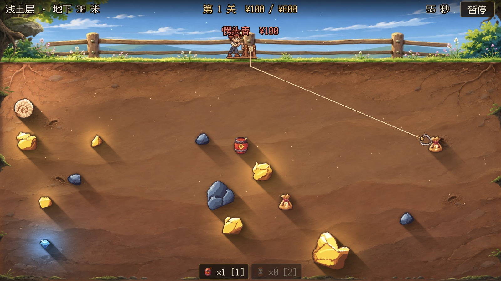
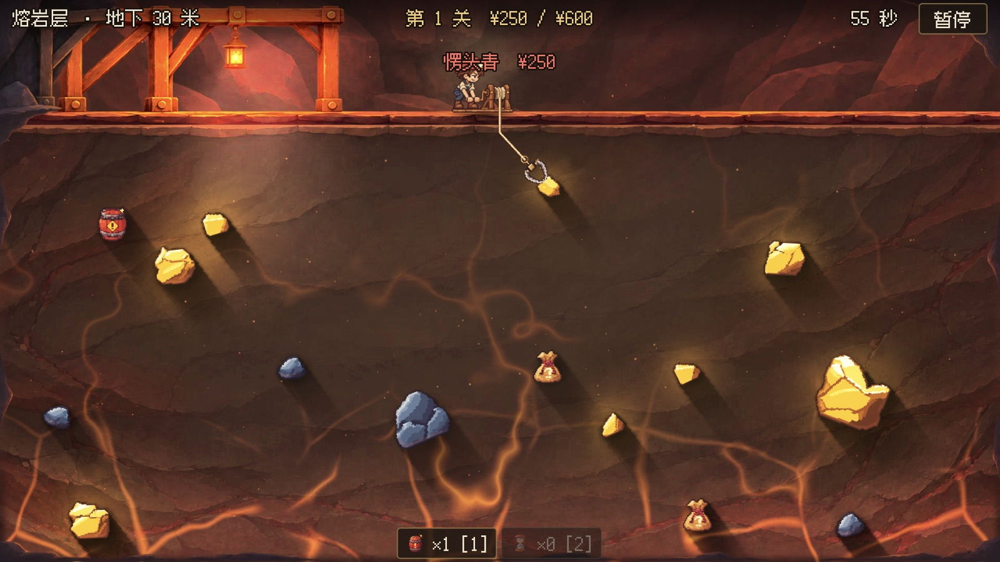
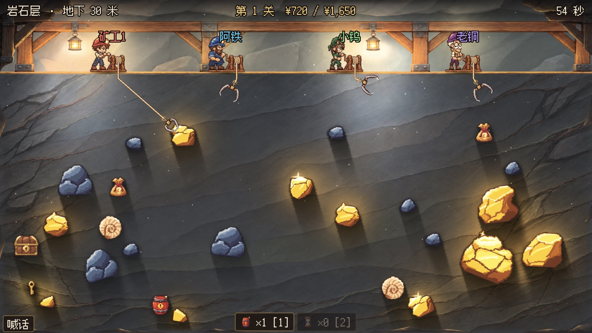

# 超级矿工

《超级矿工》是一款最多 4 人的像素风联机钩金游戏，在浏览器里玩。前端用 Godot 4，服务端用 Node.js。

## 截图


在主页选矿工，直接单人下井，也可以开房邀请朋友。



浅土层是第一站，先用小金块练出钩时机。



挖得够深就会到熔岩层，井壁和矿物上能看到岩浆的反光。



四个矿工共用一口井，合力钩金、凑够全队的过关目标。

## 玩法

等钩爪摆到合适的角度再放钩，在倒计时结束前把值钱的东西拉上来。大金块值钱但拉得慢，石头会拖时间，碰到炸药桶还可能炸掉附近的矿物。

| 模式 | 怎么玩 |
| --- | --- |
| 单人闯关 | 一个人下井，每关都要达到累计金额目标。可以暂停，失败后可以再开一局。 |
| 合作联机 | 大家在同一口井里挖，共用一个钱包。可以合拉巨型金块，也可以一人拿钥匙、另一人拉宝箱。 |
| 同屏对战 | 大家抢同一口井里的矿，各算各的钱，打满 3 局或 5 局。 |
| 分屏对战 | 每个人从同样的井开局。没到累计目标就淘汰，连钩还能给对手井里丢石头。 |

联机房间可以加电脑玩家，也可以点「本机加一人」，在同一台设备上用不同的键位一起玩。

| 角色 | 技能 |
| --- | --- |
| 愣头青 | 钩到宝袋时，开出空袋的概率减半。 |
| 老把式 | 拉重物更快。 |
| 女机械师 | 出钩和空钩收回更快。 |
| 老学究 | 商店打九折，还价时掌柜更耐心。 |

- 矿层会随关数从浅土层进入岩石层、晶洞层、熔岩层。井里能钩到金块、化石、宝石和会爬动的晶甲虫。
- 关与关之间能在商店买道具和增益，也能跟掌柜还价。炸药每次有货，其余货品随关更换。
- 第 2 关起可能遇到随机事件。金矿雨会掉下金块，塌方会掉石头，黑灯会让井里短暂变暗。开挖前会有预告。

## 操作

| 同一设备的座位 | 放钩 | 使用道具 |
| --- | --- | --- |
| 1 号 | 空格、↓，也可以用鼠标点击或触屏轻点矿井 | `1` `2` `3`，也可以点道具栏 |
| 2 号 | 回车 | `8` `9` `0` |
| 3 号 | `F` | `R` `T` `Y` |
| 4 号 | `J` | `U` `I` `O` |

道具键按道具栏从左到右对应。对战用炸药、剪刀、冰冻，合作和单人用炸药、沙漏。触屏放钩和道具栏操作对应本机 1 号座位。单人可以按 `Esc` 或点暂停按钮。

## 快速开始

1. 到 [Node.js 官网](https://nodejs.org/) 装 Node.js 24 或更新版本。选择 24 或更新的 LTS 版本即可。
2. 在本仓库的 Releases 页面下载 `super-miner-0.3.0.zip`，完整解压。
3. macOS 双击 `start.command`，Windows 双击 `start.bat`，Linux 在解压目录运行 `./start.sh`。
4. 浏览器会自动打开 `http://localhost:8060`。没打开就手动输入这个地址。关掉启动窗口就会停止游戏服务。

macOS 首次双击提示「无法验证开发者」时，在 Finder 中右键点 `start.command`，选「打开」，再确认。

**同一 WiFi 联机**

在解压目录打开终端或命令提示符，执行对应的命令。

| 系统 | 命令 |
| --- | --- |
| macOS | `HOST=0.0.0.0 ./start.command` |
| Windows（命令提示符） | 先执行 `set HOST=0.0.0.0`，再执行 `start.bat` |
| Linux | `HOST=0.0.0.0 ./start.sh` |

开房后，把房间页面「同一 WiFi」一栏里的地址发给朋友，让对方在自己的浏览器里打开。开启局域网访问后，同一网络里的人都能连到这台电脑的这个端口。

**画质**

电脑默认超高，手机和平板默认高。网址末尾可加 `?q=ultra`、`?q=high`、`?q=mid` 或 `?q=low`，对应超高、高、中、低四档。例如 `http://localhost:8060/?q=mid`。

## 开发

需要 Godot 4.7（兼容渲染器 / WebGL2）、对应的 Web 导出模板和 Node.js 24。`export.sh` 默认使用 `.tools/Godot.app/Contents/MacOS/Godot`，也可以用 `GODOT` 环境变量指定 Godot 可执行文件。把与 Godot 同版本的无多线程 Web 模板放进 `.tools/templates/`，文件名分别为 `web_nothreads_debug.zip` 和 `web_nothreads_release.zip`。打包使用 Python 3 的标准库。

| 目录 | 内容 |
| --- | --- |
| `scenes/` | Godot 场景。 |
| `scripts/` | 客户端输入、网络、界面和画面逻辑。 |
| `shaders/` | 光影、采样和画面合成着色器。 |
| `art/` | 处理后的素材和导入配置。 |
| `raw/` | 素材原图。 |
| `fonts/` | 界面字体和许可证原文。 |
| `server/` | TypeScript 服务端和自动测试。 |
| `shared/` | 客户端、服务端共用的游戏数值。 |
| `tools/` | 素材处理、截图、联调和打包脚本。 |
| `任务/` | 每项任务的要求、交付和验收记录。 |
| `shots/` | 本地生成的截图和画面测试数据。 |

| 命令 | 用途 |
| --- | --- |
| `./server.sh` | 启动开发服务，提供已导出的网页和游戏连接。 |
| `./export.sh --only` | 只导出网页到 `build/web/`。省略 `--only` 时，脚本还会在服务未启动时启动服务。 |
| `./test.sh` | 跑服务端自动测试。 |
| `./check.sh` | 检查服务端类型，需要 `server/` 的 TypeScript 开发依赖。 |
| `tools/package.sh` | 重新导出网页，并生成 `dist/super-miner-0.3.0.zip`。 |

更新素材时，把按清单命名的原图放进 `raw/`，执行 `node tools/process_assets.mjs`。脚本按 `tools/lib/spec.mjs` 处理尺寸和导入设置，为符合规格的素材生成法线贴图，结果写到 `art/`。

### 文档索引

- [联机设计说明](联机设计说明.md) 记录房间、消息格式、掉线重连和各模式规则。
- [画面风格说明](画面风格说明.md) 记录像素规格、四层光影和画质实现。
- [素材清单](素材清单.md) 列出素材的用途、尺寸和更新流程。
- [第一期验收](第一期验收.md) 记录网页环境和画面小样。
- [第二期验收](第二期验收.md) 记录联机骨架、三种联机玩法和商店验收。
- [第三期进度](第三期进度.md) 记录合作机制、随机事件、后续光影改动和待验收项。
- [任务目录](任务/) 按编号放任务要求，同编号的 `-交付.md` 和 `-验收.md` 记录实现与复核结果。

## 架构

判定、计分、过关和电脑玩家都由服务端计算。浏览器里的 Godot 客户端发送玩家操作，收到服务端快照后绘制画面。网页和 WebSocket 由同一个 Node.js 进程提供。

```text
[Godot 网页客户端] ── WebSocket：发操作 ──▶ [Node.js 服务端]
       │           ◀── WebSocket：收快照 ──        │
       └─────────── 共用 shared/balance.json ───────┘
```

## 致谢和许可

感谢 [ark-pixel](fonts/LICENSES/ark-pixel/OFL.txt)、[cubic-11](fonts/LICENSES/cubic-11/OFL.txt) 和 [galmuri](fonts/LICENSES/galmuri/LICENSE.txt) 三套像素字体的作者。字体采用 SIL Open Font License，许可证原文见 [fonts/](fonts/) 下的 `LICENSES/` 和 `OFL.txt`。

项目许可证待定。
